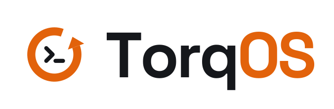

<p align="center">
  <picture>
    <source media="(prefers-color-scheme: dark)" srcset="branding/svg/lockup/torqos-lockup-for-dark-transparent.svg">
    
  </picture>
</p>

<p align="center">
  <strong>The configuration is the device.</strong><br>
  A thin, command-line operating system built on NixOS, where every change is committed, recorded
  and reversible.
</p>

<p align="center">
  <a href="https://github.com/netstacks/torqos-releases/releases/latest"></a>
  <a href="LICENSE"></a>
  
</p>

---

## Overview

TorqOS is an operating system you configure the way you configure a router or a switch. The whole
machine — its services, users, packages, network, boot and everything else NixOS can describe — is
one configuration tree. You change it from `torqcli`, a shell with operational and configuration
modes, a private candidate, `show | compare`, `commit`, `commit confirmed` and `rollback`.

Underneath, TorqOS is NixOS. Each commit becomes a git commit in the machine's own configuration
repository and a bootable NixOS generation, made by a small privileged broker that is the only
program allowed to write that repository. Every step is appended to a tamper-evident ledger, and
any change can be undone with one command.

TorqOS is deliberately small. It adds the configuration layer — the broker, the ledger and the
shell — and leaves everything else to NixOS and nixpkgs.

It has one base and two faces. For a sysadmin, a server defined in code, in git, rebuilt anywhere
from its repository. For a person, a desktop or laptop — the same base with a desktop
configuration on it — that an AI agent can be trusted to drive: the agent only proposes, the
person approves, and anything it did can be undone. The second face is being built now
(`docs/ROADMAP.md`, M3–M5).

> **Status:** early releases (`v0.1.x`). The configuration layer is complete and in daily use; the
> installable images, first-boot setup and signed releases are new. See
> [Project status](#project-status).

## Contents

- [Highlights](#highlights)
- [A first session](#a-first-session)
- [Install](#install)
- [Updates](#updates)
- [How it works](#how-it-works)
- [Security](#security)
- [Project status](#project-status)
- [Building from source](#building-from-source)
- [Repository layout](#repository-layout)
- [Documentation](#documentation)
- [Contributing](#contributing)
- [Brand](#brand)
- [Licence](#licence)

## Highlights

- **One configuration tree.** Every NixOS setting, generated from the system's own options, with
  `?` help, Tab completion and abbreviations. `show configuration` is the whole machine. What is not
  a value (a hardware file, a custom module) is a plain Nix file attached to the tree.
- **A network device's commit model.** Edit a private candidate, compare it with what is running,
  `commit check` to build without switching, `commit` to apply. `commit confirmed 5` rolls itself
  back unless you confirm it — the safe way to change SSH or networking on a remote machine.
- **Everything reversible.** `rollback <n>` loads any earlier configuration into the candidate;
  `request system revert #85` undoes one recorded change; the boot menu keeps every generation.
- **A tamper-evident history.** The broker records each proposal and change in a hash-chained
  ledger: who asked, who approved, what changed and the system it produced.
- **One writer.** Only the broker writes the configuration repository. A stray `nixos-rebuild`
  against `/etc/nixos` is refused, and a machine that drifts from its ledger says so.
- **Secure by default.** Nothing listens on the network until you ask for it. Root is locked. SSH,
  once on, is keys only unless passwords are allowed, the owner only, never root, with password
  guessing blocked.
- **Signed releases.** Images are published with signed checksums, and a machine checks the
  release key's signature on every update before loading it.
- **Thin.** No desktop, no graphical stack, no installer tools on an installed machine.
- **Ready for AI, later.** No AI is built in today, but the design keeps the door open without a
  bypass: an assistant would only ever *propose* changes through the broker, like a person, and a
  person approves them.

## A first session

`torqcli` starts in operational mode. `configure` enters configuration mode, where changes go to
your candidate until you commit them.

```text
alice@torq> show system alarms
alice@torq> configure
alice@torq# set services openssh enable true
alice@torq# set environment systemPackages htop
alice@torq# show | compare
[edit environment]
+   systemPackages [ htop ];
[edit services openssh]
+   enable true;
alice@torq# commit check
alice@torq# commit confirmed 5 comment "SSH on, keys only; htop"
alice@torq# commit
```

`commit confirmed 5` shows the comparison and the keys that will be able to log in, asks, applies
the change, and rolls it back by itself in five minutes unless the second `commit` confirms it. A
few more commands you will use:

| Command | What it does |
|---|---|
| `show configuration` | The whole active configuration (`\| display set` prints it as `set` lines) |
| `show system ledger` | Every recorded change, newest first, with its number (`#85`) |
| `rollback 1` | Load the previous configuration into the candidate, to review and commit |
| `request system revert #85` | Undo one recorded change |
| `request system update` | Move the machine to the newest signed TorqOS release |
| `request system password alice` | Change a password (kept outside the configuration) |
| `show users` | People, their groups and who is logged in |
| `help`, `?` | Help for any command or setting, wherever you are |

Scripts use the same commands: `torqcli show system alarms`, or
`torqcli -c "configure; set users users alice packages htop; commit"`. Output filters are the real
tools, sandboxed: `show configuration | grep -i ssh | wc -l`.

The full design is in [docs/CLI-DESIGN.md](docs/CLI-DESIGN.md) and the tree in
[docs/CONFIG-IS-THE-DEVICE.md](docs/CONFIG-IS-THE-DEVICE.md).

## Install

TorqOS is installed from an image: download it, check it, boot it, answer a few questions.

**1. Download** the image for your platform from the
[latest release](https://github.com/netstacks/torqos-releases/releases/latest):

| File | For |
|---|---|
| `torqos-x86_64-linux.qcow2` | QEMU/KVM, Proxmox VE, libvirt (x86_64) |
| `torqos-aarch64-linux.qcow2` | UTM on Apple silicon, QEMU (aarch64) |
| `torqos-x86_64-linux.vmdk.gz` | VMware ESXi (x86_64); `gunzip` it first |
| `torqos-aarch64-linux.vmdk.gz` | VMware on arm64; `gunzip` it first |

**2. Check it.** With the release's `SHA256SUMS`, `SHA256SUMS.sig` and `allowed_signers`, using
only OpenSSH and coreutils:

```sh
ssh-keygen -Y verify -f allowed_signers -I torqos-release -n file -s SHA256SUMS.sig < SHA256SUMS
sha256sum -c --ignore-missing SHA256SUMS
```

The first command reports `Good "file" signature for torqos-release with ED25519 key SHA256:…`.
Compare that fingerprint with the one in the release notes and in this repository
([release/allowed_signers](release/allowed_signers)), so the key is not just the download's word.

**3. Boot it** as a UEFI virtual machine with a display. The image has no user account, root is
locked, SSH is off and nothing listens on the network. Instead of a login prompt, the console shows
first-boot setup.

**4. Answer setup's questions**, asked once, like a network device's initial dialog: the machine's
name and time zone, your user name and password, and whether to allow logging in from other
machines (not at all, by password, by SSH key, or both; the default is not at all). Setup writes the
configuration, the broker builds and switches to it, and records it as change #1. The console then
shows a login prompt.

Step-by-step instructions for each hypervisor, ESXi included, are in
[docs/INSTALL.md](docs/INSTALL.md). An ISO installer for physical machines is planned.

## Updates

Releases are published to [netstacks/torqos-releases](https://github.com/netstacks/torqos-releases):
each one a git commit signed with the TorqOS release key, with the `stable` branch moved forward only
to releases that passed the tests. On a machine:

```text
alice@torq> request system update
alice@torq> configure
alice@torq# show | compare
alice@torq# commit
```

`request system update` loads the newest software into your candidate. It fetches the release
and verifies the commit's signature against the key the machine trusts (`/etc/torq/release-signers`);
an unsigned or wrongly signed release is refused and nothing is loaded. You see the change before
committing it, and `request system software rollback <n>` goes back to an earlier software version.
Almost everything is fetched pre-built and signed from NixOS's binary cache; the machine builds only
TorqOS's own small pieces.

## How it works

```text
┌────────────────────────────────────────────────────────────────┐
│ torqcli      the shell: the tree, the candidate, compare, commit │
│              (run by people; later, proposals from an assistant) │
├────────────────────────────────────────────────────────────────┤
│ torq-broker  the only writer of the configuration repository:   │
│              checks, commits, builds, switches, confirms,       │
│              rolls back; appends every step to the ledger       │
├────────────────────────────────────────────────────────────────┤
│ NixOS        the configuration repository (/var/lib/torq/config) │
│              → a NixOS generation, bootable, listed at boot     │
└────────────────────────────────────────────────────────────────┘
```

A commit travels like this:

1. `torqcli` sends the difference between the configuration your candidate was based on and your
   candidate to the broker, as one proposal, with your comment.
2. The broker checks it: the base is still current, nothing touches what only the broker may
   change, and a system change has a person's approval at a terminal.
3. It commits the change to the configuration repository, builds the new system and switches to it.
   A change that does not build changes nothing.
4. It appends the outcome to the ledger: the proposal, who approved it, the commit and the system.
5. A confirmed commit waits for confirmation; unconfirmed, the broker restores the previous system
   and configuration by itself, and records that too.

Two repositories are involved, on purpose. **This repository** is the distribution: NixOS modules,
the broker and the shell, built by everyone the same way. **Each machine's configuration
repository** is a small flake that imports a TorqOS release and holds that machine's settings, written
only by its broker. See [docs/ARCHITECTURE.md](docs/ARCHITECTURE.md).

## Security

- **Nothing listens unless asked.** No SSH, no link-local name answering (LLMNR, mDNS) — checked on
  the image by a VM test.
- **No default password.** Root is locked and never logs in over SSH; the owner's account is made
  at first boot. Passwords live outside the configuration repository, readable by the system only,
  so their hashes are not in its history.
- **SSH, safely, however it is turned on:** keys only unless passwords are allowed, three attempts
  per connection, the owner only (changeable), never root; with passwords, addresses that keep
  guessing are blocked at the firewall. A commit that changes who can log in shows it, and is
  refused if it would leave nobody able to.
- **Signed releases** for images and for updates, checked with OpenSSH alone.
- **An auditable history.** The ledger is hash-chained; `torq-broker verify` detects any change to
  it, and the machine checks at boot and every 15 minutes that it is running what the ledger says.
- **Privileged code is small Rust** with `unsafe` and dead code forbidden by the compiler.

The threat model, what is and is not protected today, and the plan for owner-rooted boot security
are in [docs/SECURITY-MODEL.md](docs/SECURITY-MODEL.md). Open issues are tracked openly in
[docs/KNOWN-GAPS.md](docs/KNOWN-GAPS.md). Please report a suspected vulnerability privately to the
maintainers rather than in a public issue.

## Project status

| Milestone | State |
|---|---|
| M1 — the trust loop: propose, apply, rebuild, ledger, one-command rollback | Done |
| M1.5 — `torqcli`: the tree, the candidate, the commit model | Done; a usability study with new users is next |
| M2 — install: images, first-boot setup, signed releases, CI | Images (x86_64, aarch64; qcow2, VMDK), setup, signed releases and CI done; the ISO installer is next |
| Later — owner-rooted boot security (own Secure Boot keys, TPM2) | Designed, not built |
| Later — the AI layers: an assistant that reads the system and proposes changes | Designed for, not built |

The roadmap is [docs/ROADMAP.md](docs/ROADMAP.md); design decisions and their reasons are recorded
as ADRs in [docs/DECISIONS.md](docs/DECISIONS.md).

## Building from source

You need Nix with flakes, on Linux (x86_64 or aarch64). The VM tests need KVM to run quickly; they
fall back to emulation without it.

```sh
nix flake check                                           # unit tests, tree checks, VM tests
nix build .#packages.x86_64-linux.image                   # the qcow2 image
nix build .#packages.x86_64-linux.image-vmdk              # the VMDK for ESXi
nix build .#checks.x86_64-linux.trust-loop                # one VM test
nix develop -c sh -c 'cd cli && cargo test'               # torqcli's unit tests
nix develop -c sh -c 'cd broker && cargo test'            # the broker's unit tests
```

The checks are `tree` (the configuration tree and its rules, evaluation only), `trust-loop`
(commits, confirmed commits, rollbacks, the ledger, the shell), `accounts`, `ssh`, `image` (from
first boot to the first signed update) and the broker's own tests. CI runs all of them on every
push and pull request, builds the images for both architectures, and publishes a release on each
`v*` tag. Working on TorqOS in a development VM is described in
[docs/DEV-SETUP.md](docs/DEV-SETUP.md).

## Repository layout

```text
flake.nix          the entry point: packages, images, VM tests, the machine template
modules/           the distribution, as NixOS modules (torq.* options)
cli/               torqcli, the shell (Rust)
broker/            torq-broker, the privileged writer, ledger and rollback (Rust)
templates/config/  the configuration repository each machine starts from
hosts/image/       the installable image; hosts/dev-vm/ a development VM
tests/             NixOS VM tests and the configuration tree's checks
release/           the release key's public half (allowed_signers)
branding/          the TorqOS logo, icons, terminal logos and palette
docs/              design, decisions, install, security, roadmap
.github/workflows/ test, image, release and the weekly nixpkgs update
```

## Documentation

| Document | What it covers |
|---|---|
| [VISION](docs/VISION.md) | What TorqOS is for, and what it deliberately is not |
| [ARCHITECTURE](docs/ARCHITECTURE.md) | The layers, the change flow, the broker and the ledger |
| [CLI-DESIGN](docs/CLI-DESIGN.md) | `torqcli`: modes, commands, the commit model |
| [CONFIG-IS-THE-DEVICE](docs/CONFIG-IS-THE-DEVICE.md) | The configuration tree and its files |
| [INSTALL](docs/INSTALL.md) | Images, checking a download, hypervisors, first-boot setup, updates |
| [SECURITY-MODEL](docs/SECURITY-MODEL.md) | Threat model, defaults, accounts and passwords, releases |
| [DECISIONS](docs/DECISIONS.md) | Architecture decision records |
| [ROADMAP](docs/ROADMAP.md) | What is done and what comes next |
| [KNOWN-GAPS](docs/KNOWN-GAPS.md) | Open issues and limits, stated plainly |
| [AI-LAYER](docs/AI-LAYER.md) | The later AI layers, and how today's design keeps them safe |
| [DEV-SETUP](docs/DEV-SETUP.md) | Developing TorqOS in a VM |

## Contributing

Contributions are welcome. Read [CONTRIBUTING.md](CONTRIBUTING.md) first. In short: every commit is
signed off under the [Developer Certificate of Origin](DCO) (`git commit -s`); privileged code has
no `unsafe` and no dead code; every security or reversibility claim comes with a test that would
fail if it broke; and the documentation changes with the behaviour it describes.

## Brand

The TorqOS mark is a counter-clockwise ring — torque, and rollback — around a `>_` prompt. The
logo, icons, terminal logos and palette, with guidance on using them, are in
[branding/](branding/README.md).

## Licence

TorqOS is licensed under the [Apache License 2.0](LICENSE). The licence does not grant rights to the
TorqOS name or logo (its section 6); see [branding/](branding/README.md).
